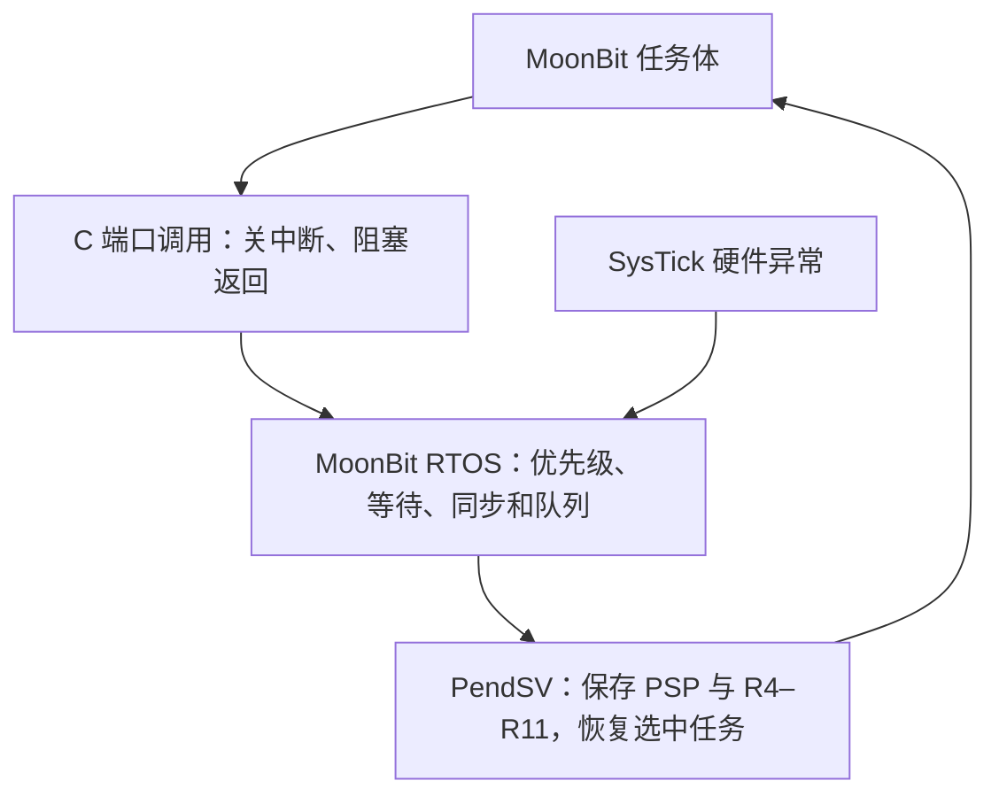

# Cortex-M3 运行与接口

## 平台与构建

目标为 QEMU MPS2 AN385，Cortex-M3，Thumb，无宿主操作系统。FLASH 从 0 开始、RAM 从 0x20000000 开始，UART0 位于 0x40004000。布局由 `ports/cortex-m3/link.ld` 定义；不直接适用于 STM32 等不同外设映射的芯片。

固定 MoonBit `0.10.15+943464bfa`，必须同时安装匹配 core 并 bundle native。脚本使用工具链提供的 `moonbit.h`、`moonbit_runtime.h` ABI；改变编译器后必须重新验证。ARM GCC、QEMU 放在 PATH，或指定 `ARM_GCC`、`QEMU_ARM`。`MOON_HOME` 指向工具链目录，Windows 本工作区放在 D 盘。

```sh
python scripts/rtos.py --scenario 3 --verbose
python scripts/rtos.py --scenario 5 --output _build/reproduce
python scripts/rtos.py --fault stack
python scripts/rtos.py --fault allocation
```

`--build-only` 只编译，不产生运行验证结论。执行参数为 `-M mps2-an385 -nographic -semihosting -icount shift=10,align=off,sleep=off`。UART 是目标外设输出；semihosting 仅用于验证进程退出。加速虚拟时间和主机墙钟时间不能当作 MCU 延迟指标。

## 分层与执行



复位初始化数据/BSS，调用 MoonBit 全局初始化、建立固定资源和独立栈。SVC 进入首个 PSP 任务；SysTick 推进 tick、处理超时并触发 PendSV。PendSV 保存现场并询问 MoonBit 的 `pick()`，C 中没有另一份调度算法。任务返回后进入退出路径；无就绪业务任务时 idle 执行 WFI。

任务为特权 Thread 模式，IRQ mask 保护内核入口与引用计数访问；无权限隔离。端口 API 由任务调用，ISR 只允许 `give` / `send_isr` 等不阻塞通知，示例由 SysTick 投递。更高优先级外部 IRQ 驱动未验证。

## 核心语义

| 内容 | 行为 |
|---|---|
| `create(id,p)` | 槽 0–15，优先级 0–31；纯核心允许退出后重置槽；裸机仅启动时创建 |
| `pick()` | 有效优先级优先，同优先级按就绪序号 FIFO |
| `advance(n)` | tick 按 32 位回绕，Int64 算术；单次 n 为 0–1,000,000；正数推进轮转当前任务 |
| 延时/让出 | `sleep` 进入延时等待；`yield_task` 重排就绪次序 |
| 信号量 | 有界计数；优先唤醒最高优先级等待者，直接交付不同时增加计数 |
| 互斥锁 | 单持有者、非递归、拒绝等待环；至多 16 轮传递继承；超时/解锁/退出后重算 |
| 队列 | 有界整数 FIFO；阻塞发送保留一个值；接收腾空后恰好补入一次；超时/退出清理等待 |
| 等待顺序 | 优先级优先，同优先级按任务就绪序号；不承诺跨优先级公平 |

返回码：0 成功、1 已阻塞、-1 非法参数/状态、-2 超时、-3 轮询不可用/已满、-4 非持锁者、-5 递归或循环锁等待。timeout 为 -1 永久等待、0 轮询、正数相对 tick（最多 1,000,000）。纯核心返回 1 后由调用方推进调度并读取 `completion`；裸机包装保存上下文，等原任务恢复后返回最终状态。

同一次 SysTick 按“先时钟和超时、再投递事件”处理。已超时任务不吞掉新令牌/消息，可再次轮询取得。事件为定时器与合成整数源，不是实体传感器。

## 内存与错误

初始化创建 19 个常驻对象，之后不创建字符串、闭包、可增长集合或临时堆对象。`runtime.c` 提供 boot arena、数组和常驻引用计数适配；冻结后的分配、释放到零或 panic 均终止运行，不能作为通用垃圾回收实现。编译器会内联 allocator，因此同时封锁 `malloc` 和数组分配。

每任务槽 4 KiB 栈，底部 64 字节哨兵；切换时检查 PSP 与哨兵。trace 保存 4096 条，导出前 256 条，溢出计数单列；压力测试不是全量轨迹。`switch_count` 只在任务身份变化时增加；`TASK_RUNS` 是恢复次数，可能含恢复同一任务。

## 修改应用

`firmware/application.mbt` 是实际目标任务；`port.c` 启动配置选择任务、优先级和资源。修改后重新验证。任务只使用无需分配的值和已有 FFI；引入新运行时符号或堆对象的语言特性必须先适配。固件是单独模块，通过脚本直接编译父目录的核心源文件，不通过宿主 `moon run` 启动。

参考：[QEMU 平台文档](https://www.qemu.org/docs/master/system/arm/mps2.html)、[MoonBit FFI](https://docs.moonbitlang.com/en/latest/language/ffi.html)、[Arm Cortex-M3 用户指南](https://developer.arm.com/documentation/dui0552/latest/)。没有实体板结果或硬实时最坏时间证明。
